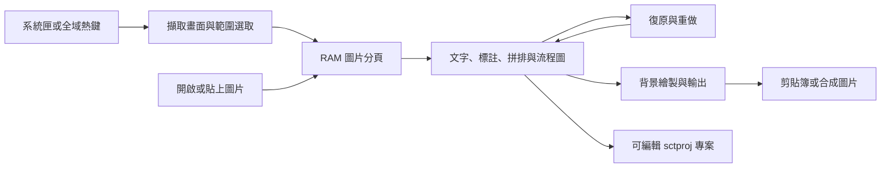

# Simple Capture Tool｜簡易螢幕擷取工具

適用於 Windows 的免安裝螢幕截圖、圖片標註工具。平時常駐系統匣，透過快捷鍵擷取畫面，接著在同一個工作區編輯、拼排與複製多張圖片，適合製作操作教學、問題回報和圖文說明。

- 系統需求：Windows 10 1903 或更新版本，x64。
- 介面語言：預設繁體中文，可切換英文或使用自訂翻譯。
- 設定方式：INI 檔隨程式攜帶，不需安裝 Python。

使用手冊：[繁體中文（預設）](docs/USER_GUIDE.md) · [English](docs/USER_GUIDE_EN.md)

## 架構與操作流程

- `src/core`：圖片與標註模型、選區、物件幾何、連線及復原狀態。
- `src/services`：Windows 擷取、圖片與專案編解碼、文字繪製、剪貼簿及輸出。
- `src/ui`：系統匣、截圖選取器、多分頁編輯工作區與工具面板。
- 圖片像素透過共用唯讀資料保留；編輯操作建立新的文件狀態，供復原及背景輸出使用。
- 畫面繪製與編碼在背景工作執行；結果回到對應分頁後，先確認文件狀態仍適用。

## 主要功能

| 類別 | 功能 |
| --- | --- |
| 畫面擷取 | 全螢幕、單一螢幕、指定視窗、矩形／橢圓／自由手繪／多區域、固定區域、自由／常用／自訂比例、延遲擷取、重複上次區域與命名區域預設 |
| 長畫面 | 自動捲動截圖、垂直／水平手動拼接與重疊像素調整 |
| 圖片標註 | 局部文字格式、直線／曲線／直角折線箭頭、矩形／橢圓／多邊形、自由畫筆、可混色的矩形螢光筆、可拖曳尾端的對話框、數字圖章、遮蔽、一般／隱私馬賽克、模糊、橡皮擦、複製修補筆與取色器 |
| 多圖編輯 | RAM 分頁暫存與可編輯副本、截圖插入目前圖片、跨圖複製貼上、多圖編排、分割圖片、選區建立新圖片、可擴充／縮小畫布、物件分組／鎖定／對齊、拖曳連續複製與範本、圖層及屬性側欄 |
| 流程討論 | 拖入流程節點與自製討論符號、圖形內文字、附著直線／折線、箭頭或無箭頭連接、連線標籤、方向快速延伸、配色與流程排列，可與截圖混排 |
| 選區與幾何 | 矩形／橢圓／套索／依色像素選區、反選與擴張／收縮、選區框線、可還原的圖片物件裁切、精準裁切、自動偵測外圍、縮放、旋轉／翻轉、四角透視校正 |
| 調色與效果 | 調色、亮度直方圖／黑白點、Gamma、復古褐色、顏色替換／轉透明、色階縮減、邊框、陰影、背景、浮水印、效果預覽及圖片比較 |
| 輸出 | 縮放匯出／複製、手動多分頁批次匯出、JPG、PNG、BMP、靜態 GIF、PDF、列印、含圖片與說明的單檔 HTML 教學，以及保留可編輯物件的 `.sctproj` 專案、拖曳合成圖片至相容應用程式 |

## 快速開始

1. 取得此倉庫，例如使用 GitHub 的 **Code → Download ZIP**，並解壓縮至可寫入的資料夾。
2. 執行正式版 [build/SimpleCaptureTool.exe](build/SimpleCaptureTool.exe)。程式啟動後會直接常駐右下角系統匣，不顯示主視窗。
3. 按 `Ctrl+Shift+X` 選取矩形區域，放開滑鼠後進入最大化的圖片編輯視窗；也可由系統匣右鍵選單選擷取模式。
4. 加入箭頭、文字、框線或螢光筆。按 `Ctrl+A`、`Ctrl+C`，等到「圖片已複製到剪貼簿」提示後，再貼到其他程式；或按 `Ctrl+S` 儲存，新圖片會先要求儲存位置與檔名。

- 單張插入與貼上保留原始像素尺寸；畫布不足時向右／下擴充。另有「插入圖片（縮入畫布）」選項。
- 圖片不會自動存檔。已有圖片檔案路徑時，「儲存／Ctrl+S」直接寫回目前檔名，保留原副檔名。
- 新圖片首次儲存與「另存新檔」須指定檔名，預設格式為 JPG；首次對話框開在 Windows Downloads，之後優先使用上次成功儲存的資料夾。
- 擷取放大鏡會避開游標、選區與工具列；空間不足時暫時隱藏。
- 首次啟動會在 EXE 旁產生 `SimpleCaptureTool.ini`、`lang_tw.ini` 與 `lang_en.ini`。
- 截圖與圖片編輯使用 Windows 內建服務，不需下載額外編碼器。

## 常用快捷鍵

以下為預設設定；若已自訂，請以程式設定為準。

| 快捷鍵 | 動作 |
| --- | --- |
| `Ctrl+Shift+1` | 全螢幕截圖 |
| `Ctrl+Shift+X` | 矩形區域截圖 |
| `Ctrl+Shift+3` | 指定視窗截圖 |
| `Ctrl+Shift+6` | 重複上次區域 |
| `Ctrl+Shift+7` | 擷取游標所在的螢幕 |
| `Ctrl+A`、`Ctrl+C` | 編輯器中選取並複製整張合成圖 |
| `Ctrl+V` | 貼上圖片或可編輯物件 |
| `Ctrl+S` | 儲存目前圖片；沒有檔名時選擇位置與檔名 |
| `Ctrl+Z`／`Ctrl+Y` | 復原／重做 |
| `Home`／`End` | 將選取物件移至最上層／最下層 |
| `Ctrl+滾輪`／`Shift+滾輪` | 以游標位置縮放／水平捲動畫布 |
| `Shift`＋繪圖／拖曳縮放控制點 | 正方形、正圓、45° 線條／保持物件外框比例 |
| 選單鍵／`Shift+F10` | 開啟畫布快捷選單 |
| `Ctrl+Shift+P` | 搜尋編輯命令 |
| `Ctrl+Tab`／`Ctrl+Shift+Tab` | 切換圖片分頁 |

全域截圖快捷鍵可從「設定 → 全域快捷鍵」調整，也可將 Print Screen 指定為全螢幕截圖。編輯器內的快捷鍵則從「編輯 → 命令與快捷鍵 → 編輯快捷鍵」設定。

## 多張圖片的編輯方式

每次截圖會新增一個獨立分頁，圖片及標註可先保留在 RAM，不必立刻存檔。

1. 在圖片 A 加入文字、紅框或數字圖章。
2. 點空白處完成編輯，再按 `Ctrl+A`、`Ctrl+C`。
3. 切到圖片 B，按 `Ctrl+V`；整張 A 會成為一個可移動、縮放的圖片物件，A 的原始標註仍可繼續編輯。
4. 繼續貼入其他圖片及說明，最後複製或儲存合成結果。

- **畫布與排版**：拖曳畫布邊界增加空白，或將既有物件排成橫列、直列及網格；也可分割圖片或從選區建立新分頁。
- **標註重用**：物件範本保留選取的可編輯標註及圖片素材，不含原始截圖底圖；工具樣式可跨分頁套用到相容物件。
- **精準編輯**：文字框支援內距、行距、自動增高及尋找／取代；箭頭支援端點樣式與物件附著。線寬可輸入 1～128 像素，並使用上下箭頭調整。
- **素材與外形**：PNG 素材庫提供原尺寸插入；圖片物件可裁切、替換內容、調色及套用外形遮罩。完整素材仍會保留，遮罩及羽化不屬於隱私遮蔽。
- **選取與檢視**：支援像素選區交集、透明度選區、色彩預覽、物件路徑掃選與畫布格線。預覽與格線不會輸出到圖片。
- **輸出**：選取標註可單獨匯出透明 PNG 或 SVG；複雜外觀使用內嵌 PNG 時會先詢問。多頁輸出前會指出尚未完成編輯的分頁。

詳細參數、限制與操作方式見[使用手冊](docs/USER_GUIDE.md)。

截圖工具列平常保持位置，可直接操作；拖曳選區時才會避讓。按 Tab 可隱藏／顯示工具列，從原本遮住的位置開始選取。

## 自訂介面與語言

功能列以「筆觸」「編號圖章」「尺寸畫布」「旋轉翻轉」等分類顯示工具，圖示對應目前快捷動作。滑鼠停留可查看目前動作及同類功能；主圖示重複目前動作，下箭頭可選擇其他功能。

- 「常用 → 自訂常用」可選擇功能群組、群組內項目及顯示順序；未加入常用的功能仍可從最上方「編輯」選單使用。
- 「檢視」提供物件／圖層與物件屬性側欄；可調整名稱、顯示狀態、鎖定、層級、座標、尺寸及相容的樣式屬性。
- 切換工具或執行編輯命令時，會先套用側欄中的有效屬性；無效值會保留供修正。
- 編輯文字時可捲動畫布；輸入框會跟隨文字位置，移出可見範圍時暫時隱藏，捲回後可繼續編輯。
- 「設定 → 主頁功能選擇」調整主視窗按鈕；「設定 → 一般設定 → 語系」切換介面語言。
- 可複製 `lang_en.ini` 為其他 `lang_*.ini`，自行翻譯文字；參見[語系說明](docs/USER_GUIDE.md#語系與可攜式設定)。

## 資料保存與安全

- 關閉圖片分頁、編輯視窗、主視窗關閉回系統匣或結束程式時，未儲存的 RAM 圖片會直接丟棄，不再詢問。
- 需保留的圖片須先儲存；最小化或使用「縮到系統匣」隱藏編輯器會保留圖片。

- 儲存一般圖片會輸出合成結果；需要下次修改文字與物件時，請另存 `.sctproj`。RAM 復原清單不會保存到下次啟動。
- `.sctproj` 內含原圖及素材。分享敏感內容前，請使用實色遮蔽並輸出合成圖片，不要直接分享可編輯專案；馬賽克、模糊、外形遮罩與羽化不等同安全移除資訊。
- 匯入外部圖片時會校正 EXIF 方向，並透過 Windows WIC 將內嵌 ICC 色彩描述檔轉成 sRGB。圖片在本機編輯，工具不提供雲端上傳功能。
- 捲動拼接、受保護畫面及部分遠端桌面／GPU 環境可能有擷取限制；分享前請檢查輸出內容。

## 文件

- [繁體中文使用手冊（預設）](docs/USER_GUIDE.md)／[English user guide](docs/USER_GUIDE_EN.md)：擷取、編輯、快捷鍵、語系及操作限制。
- [從原始碼建置](docs/BUILDING.md)：Visual Studio 環境、相依元件與建置指令。
- [更新 GitHub](docs/PUBLISHING.md)：專案內 batch 入口、預覽與提交操作。
- [第三方元件說明](THIRD_PARTY_NOTICES.md)：Windows 建置元件說明。
